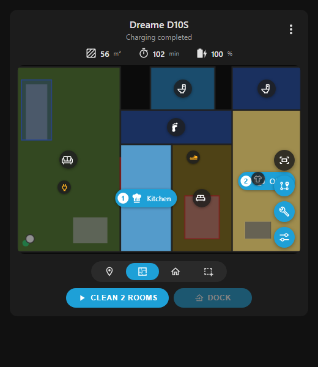

# Dreame D10S Card

[](https://hacs.xyz/docs/faq/custom_repositories/)
[](https://github.com/EthanetXYZ/dreame-d10s-card/releases)
[](LICENSE)

A Home Assistant dashboard card for the **Dreame D10S** robot vacuum. It gives you the map, room/zone/spot cleaning, a map editor and the robot's settings in one card, much like the Dreame app.



*Selecting rooms for cleaning (captured from the bundled demo page).*

> This is an independent community project. It isn't affiliated with Dreame or with the official Dreame Vacuum Card, and contains no code from it.

## Requirements

- Home Assistant 2024.8 or newer
- The [Dreame Vacuum integration by Tasshack](https://github.com/Tasshack/dreame-vacuum), set up with your D10S
- [HACS](https://hacs.xyz/) (recommended, for installing and updating)

The card is built and tuned for the D10S. Other Dreame robots supported by the integration may work, but only the D10S is targeted.

## Features

**Cleaning**
- Live map, with pinch or scroll-wheel zoom and pan
- Optional **floor plan view** that draws the map in the card itself (see below)
- Spot, Room, All and Zone cleaning
  - Room: tap rooms to select them; the order you tap them is the cleaning order
  - Zone: drag to draw up to 5 zones, then move, resize or delete them
  - Spot: tap to place up to 5 spots
- Clean, Pause, Resume, Stop and Dock buttons that follow the robot's state
- Status, cleaned area, cleaning time and battery at a glance
- Alerts for errors, the robot being offline, low battery, a missing water tank and worn parts

**Map editor**
- **Rooms**: rename, choose a room type (which also sets its icon), set per-room suction, water, mode and number of passes, split a room with a line, or merge two rooms
- **No-go zones**, **no-mop zones** and **virtual walls**: your existing ones are loaded; draw, resize or delete them, then save
- **Cleaning order**: tap rooms in the order you want, then save

**More**
- **Maintenance**: brush, filter, sensor and mop pad life, with reset
- **Cleaning history**: totals, plus each past clean with its map
- **Maps**: switch, rename, back up and delete saved maps, restore an earlier version, or start a new map
- **All settings**: every setting the integration exposes for your robot, searchable, including do-not-disturb and volume
- **Obstacles**: markers on the map for obstacles the robot reports
- **Panel mode**: a layout for tablets and wall displays, with the map on the left and settings in a side column. It turns on automatically when the card is wide enough.
- **Themes**: uses your Home Assistant theme's colors, and works with glass themes such as [Frosted Glass](https://github.com/wessamlauf/homeassistant-frosted-glass-themes)

The card only shows what your robot reports. Anything the D10S doesn't support stays hidden.

## Installation

### HACS (recommended)

1. In HACS, open the **⋮** menu and choose **Custom repositories**.
2. Add `https://github.com/EthanetXYZ/dreame-d10s-card` with type **Dashboard**.
3. Search for **Dreame D10S Card** in HACS and download it.
4. Refresh your browser.

HACS adds the dashboard resource for you and will offer updates when new versions are released.

### Manual

1. Download `dreame-d10s-card.js` from the [latest release](https://github.com/EthanetXYZ/dreame-d10s-card/releases/latest) and copy it to `<config>/www/`.
2. Go to **Settings → Dashboards → ⋮ → Resources → Add resource**, enter `/local/dreame-d10s-card.js` and choose **JavaScript module**.
3. Refresh your browser.

## Adding the card

Add it from the dashboard editor (search for **Dreame D10S Card**), or with YAML:

```yaml
type: custom:dreame-d10s-card
entity: vacuum.dreame_d10s
```

Replace `vacuum.dreame_d10s` with your vacuum's entity ID.

### Options

| Option            | Default                  | Description |
|-------------------|--------------------------|-------------|
| `entity`          | required                 | Your vacuum entity |
| `title`           | the vacuum's name        | Title shown at the top of the card |
| `layout`          | `auto`                   | `auto`, `compact` or `panel` |
| `floor_plan`      | `false`                  | Start in floor plan view (you can also switch from the ⋮ menu) |
| `show_stats`      | `true`                   | Show the area, time and battery row |
| `show_obstacles`  | `true`                   | Show obstacle markers on the map |
| `map_entity`      | `camera.<name>_map`      | Only needed if your map camera has a different name |
| `map_data_entity` | `camera.<name>_map_data` | Only needed if your map data camera has a different name |
| `entities`        | –                        | Point the card at differently named entities, e.g. `{ suction_level: select.my_suction }` |

The card finds the robot's other entities from the vacuum's name, so for `vacuum.dreame_d10s` it looks for `select.dreame_d10s_suction_level`, `sensor.dreame_d10s_battery_level` and so on.

### Floor plan view

Instead of the map image, the card can draw the map itself from the integration's map data. Room highlighting then follows each room's exact shape, and map edits show up straight away.

To use it, enable your vacuum's **Map Data** camera entity (`camera.<name>_map_data`, which the integration disables by default). Then choose **Floor plan view** from the card's ⋮ menu.

### Good to know

- Map editing only works on a saved map, and not while the robot is cleaning.
- Per-room settings are only used while **Customized room cleaning** is turned on.
- After splitting or merging rooms, the robot takes a few seconds to update the map.

## Issues and feedback

Found a bug or have an idea? Please [open an issue](https://github.com/EthanetXYZ/dreame-d10s-card/issues). Include your Home Assistant version, the integration version, and a screenshot if something looks wrong.

## Development

The repository includes a demo page that runs the card against a mocked Home Assistant with a sample map. You need [Node.js](https://nodejs.org/).

```bash
node demo/serve.cjs
```

Then open http://localhost:8765. Add `?layout=panel` for panel mode, or `?theme=frosted-light` / `?theme=frosted-dark` to preview a glass theme.

## License

[MIT](LICENSE)
